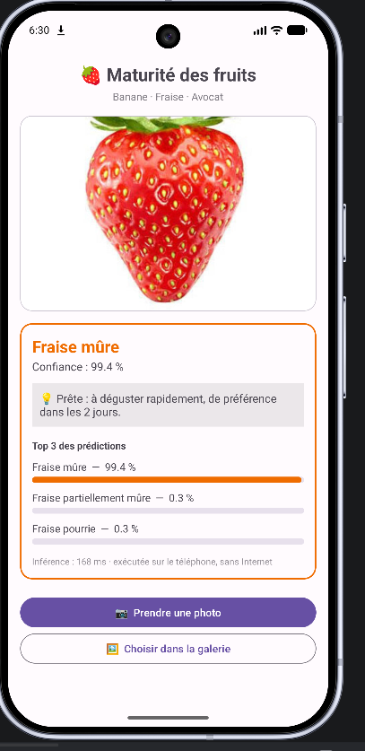
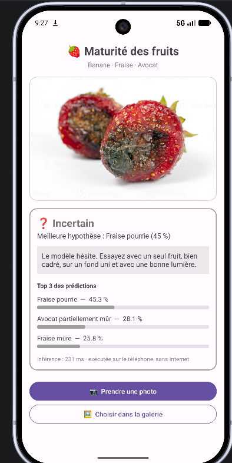
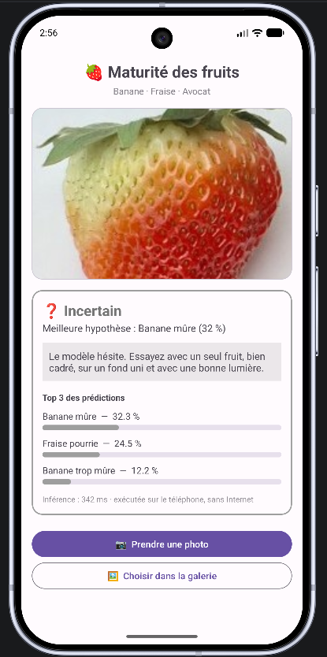
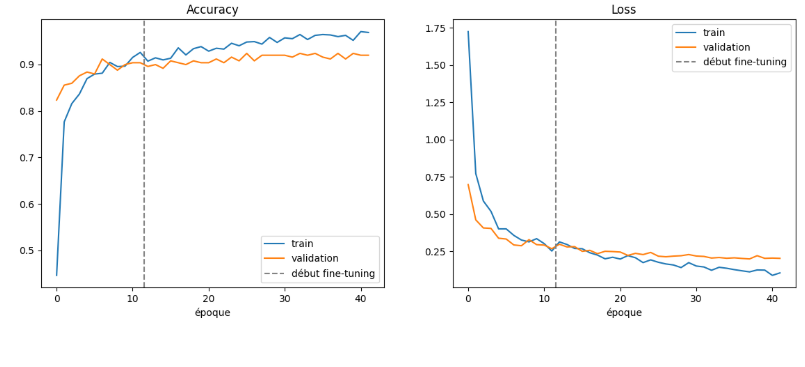
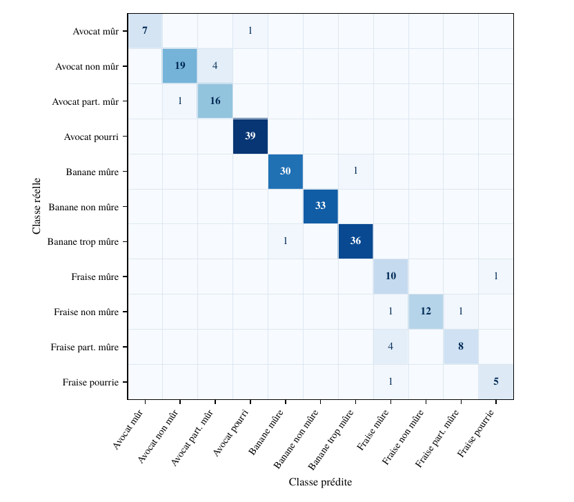

# Maturité des fruits avec MobileNetV2

Application Android qui reconnaît **le fruit et son stade de maturité** à partir d'une photo, **directement sur le téléphone** (sans Internet ni serveur).
*Android app that classifies fruit ripeness on-device with a quantized MobileNetV2 (TensorFlow Lite).*

- **3 fruits, 11 classes** : banane (non mûre, mûre, trop mûre), fraise et avocat (non mûr, partiellement mûr, mûr, pourri).
- **93,1 % d'exactitude** sur un jeu de test jamais vu (215 images sur 231, F1 macro 0,90, intervalle de confiance à 95 % : 89,0 % à 95,7 %).
- **Modèle TensorFlow Lite de 2,5 Mo** (23,1 Mo en Keras), 99,6 % de prédictions identiques après quantification.

Projet du cours de Deep Learning, École Mohammadia d'Ingénieurs (EMI, Rabat), Département Modélisation et Informatique Scientifique, 2026-2027.
Réalisé par **Hayat Waldi** et **Khaoula Elhonnya**, sous l'encadrement du **Pr. Fikal**.

## Aperçu de l'application

| Résultat fiable | Confiance sous 70 % : « Incertain » | Cas difficile |
| --- | --- | --- |
|  |  |  |

L'application affiche le stade le plus probable, la confiance, les trois meilleures hypothèses et un conseil pratique. Quand la confiance est sous 70 %, elle répond « Incertain » au lieu de se tromper avec assurance.

## Méthode

1. **Données** : deux jeux publics annotés au format YOLO (bananes ; fraises et avocats), soit 1 431 photos et 1 598 fruits recadrés. Découpage 70/15/15 **par photo d'origine** (1 118 / 249 / 231 images) pour éviter les fuites d'information.
2. **Modèle** : MobileNetV2 pré-entraîné sur ImageNet, puis tête de classification (pooling moyen global, dropout 0,3, dense 11 + softmax). Prétraitement et augmentation (sans changement de teinte) intégrés au modèle. Poids de classes « balanced ».
3. **Entraînement en deux phases** : tête seule (Adam 1e-3), puis fine-tuning des 40 dernières couches (Adam 1e-5, BatchNorm gelées), avec EarlyStopping et ReduceLROnPlateau.
4. **Conversion** : TensorFlow Lite avec quantification dynamique des poids sur 8 bits.
5. **Application** : Kotlin, interpréteur TensorFlow Lite 2.17.0, analyse de l'image et de son miroir (moyenne des probabilités), seuil de confiance de 70 %.

## Résultats

| Mesure | Valeur |
| --- | --- |
| Exactitude de test (Keras) | 93,07 % (215/231) |
| Exactitude de test (TFLite quantifié) | 92,64 % (214/231) |
| F1 macro | 0,897 |
| Taille du modèle | 23,1 Mo (Keras), 2,5 Mo (TFLite) |
| Inférence | 19,6 ms (CPU Kaggle), 46 à 380 ms (émulateur Android) |

Aucune des 16 erreurs ne confond deux fruits différents : elles se situent entre stades voisins d'un même fruit. Détails, matrice de confusion et expériences dans le [rapport](docs/rapport/Rapport_Projet_Maturite_Fruits.pdf).

<p>


</p>

## Limites

- Le jeu de test est petit (231 images, 6 à 14 images par classe de fraise) : les pourcentages sont à prendre avec une marge d'environ 3 points.
- Le modèle est moins fiable sur des photos très différentes de l'entraînement (photos du web, plusieurs fruits sur la même image, fonds chargés). Ajouter 624 bananes d'un autre jeu de données a fait baisser le score à 86,6 %, à cause d'étiquettes incohérentes entre les deux jeux.
- Un fruit visiblement moisi peut être classé « mûr » : le modèle s'appuie surtout sur la couleur. **Cet outil ne doit pas servir à décider si un fruit est sûr à consommer.**
- L'application a été testée sur un émulateur Android, pas sur un téléphone physique.

## Contenu du dépôt

```
android/          Projet Android Studio (Kotlin) avec le modèle dans app/src/main/assets
notebooks/        Notebook d'entraînement et d'évaluation (exécuté sur Kaggle)
models/           Modèle Keras, modèle TensorFlow Lite et labels.txt
docs/rapport/     Rapport de 67 pages (PDF) et sources LaTeX
screenshots/      Captures de l'application et figures de résultats
```

## Lancer l'application

1. Ouvrir le dossier `android/` dans Android Studio (minSdk 24).
2. Lancer sur un émulateur ou un téléphone : le modèle `fruit_ripeness.tflite` est déjà dans les ressources de l'application.

## Refaire l'entraînement

Le notebook `notebooks/deeplearning_project.ipynb` a été exécuté sur Kaggle ; ses chemins (`/kaggle/input/...`) sont à adapter. Les jeux de données ne sont pas inclus dans ce dépôt, il faut les télécharger depuis leurs sources (références dans la bibliographie du rapport) :

- *Banana Ripeness Classification Dataset* (Mendeley Data)
- *Comprehensive Dataset on Ripening Stages of Strawberries and Avocados From Unripe to Rotten* (Data in Brief, 2025)

L'ordre des 11 sorties du modèle est l'ordre alphabétique de `models/labels.txt` : ce fichier doit toujours provenir du même entraînement que le modèle.

## Références

Howard et al., *MobileNets* (2017) ; Sandler et al., *MobileNetV2: Inverted Residuals and Linear Bottlenecks* (CVPR 2018) ; documentation Keras Applications, TensorFlow Lite et Android Developers. Liste complète dans le rapport.
